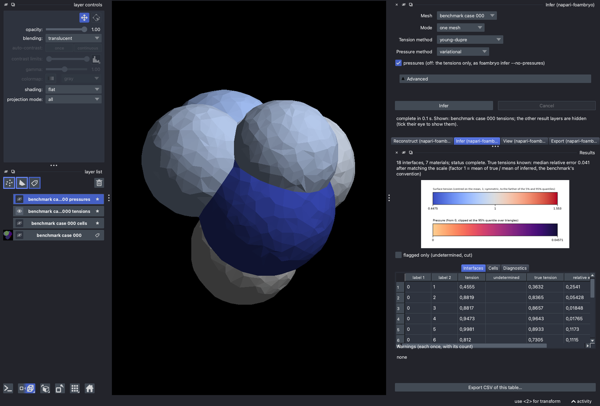
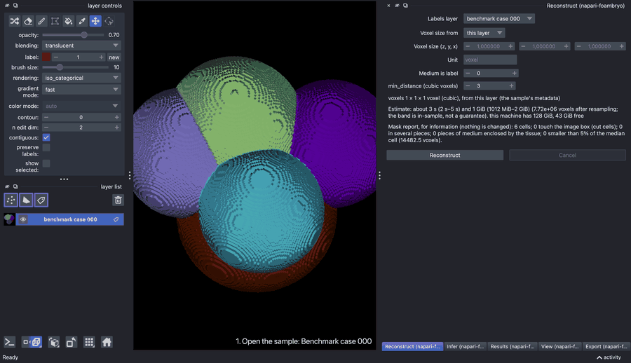
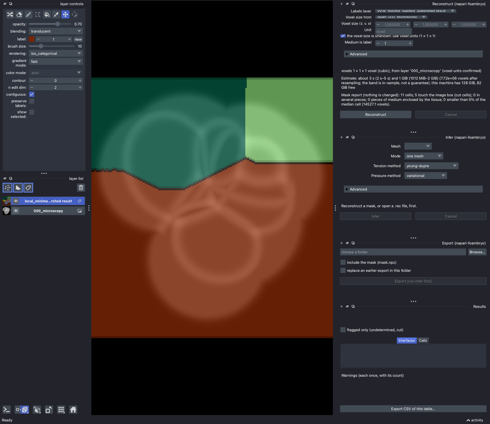

# napari-foambryo

A napari plugin over delaunay-watershed and foambryo: reconstruct the multimaterial mesh of a 3-D or 2-D segmentation, infer its relative surface tensions and cell pressures, show them on the tissue, and export the same files as the `foambryo` command. A 2-D segmentation goes through the same docks: its interfaces are drawn as curves coloured by tension and its cells as polygons coloured by pressure, over the labels.

Version 0.2.0, which adds 2-D segmentations, released with delaunay-watershed 0.8.0 and foambryo 0.8.0. Licence: GPL-3.0-or-later. What changed: the [CHANGELOG](https://github.com/VirtualEmbryo/napari-foambryo/blob/v0.2.0/CHANGELOG.md).



*Benchmark case 000 (6 cells): the tensions of its outer interfaces on the reconstructed mesh (blue below the mean tension, grey at it, red above), the colour bars and the table, in which the true tensions of this simulated aggregate are shown beside the inferred ones. foambryo's Polyscope viewer shows the same colours for the same mesh.*

## What it does

* **Reconstruct**: a Labels layer, whoever made it (a file, napari's tools, another segmentation plugin), becomes a multimaterial mesh by delaunay-watershed's default reconstruction, the one `foambryo mesh` runs. The voxel (or pixel) size comes from the layer, from another layer (the image that was segmented) or is typed: it is never guessed. Before a 3-D run the dock shows the estimated time and memory, and, in 2D and 3D, a report of the mask (cells, cells touching the image box, cells in several pieces, very small labels). The reconstruction runs in a separate process: **Cancel** stops it at once and frees its memory.
* **Infer**: the tensions, then the pressures, by foambryo's `infer_forces` with the options and defaults of `foambryo infer`; or, in 3D, a **seed ensemble** (`infer_tensions_over_seeds`), whose spread over the seeds is a lower bound on the error.
* **Results**: the tensions and pressures on the mesh, coloured as foambryo's own viewer colours them, the colour bars, and the tables. Select a row to see its interface or cell.
* **Export**: `mesh.rec`, `tensions.csv`, `pressures.csv`, `colour_bars.png` and `run.json`, the files of the `foambryo` command, with the command lines that reproduce them.

**2D and 3D, one experience.** The input decides the dimension: a 3-D Labels layer `(Z, Y, X)` is meshed and inferred in 3D, a 2-D layer `(Y, X)`, or a layer holding one plane `(1, Y, X)`, in 2D, through the same five docks; a `.rec` file opens in its own dimension. What each dock does with a 2-D tissue is in [Two-dimensional tissues](#two-dimensional-tissues) below.

**One code path.** The plugin computes nothing of its own: every number is one that a public function of foambryo returns for the same mask and options, the functions the `foambryo` command calls. The tests check this bit for bit, and check that the exported files are byte for byte those of the command.

## Installation

In a virtual environment:

```bash
pip install "napari[all]" napari-foambryo
```

It needs Python 3.12 or later, napari 0.9 or later, and delaunay-watershed 0.8.0 and foambryo 0.8.0, which pip installs with it (`delaunay-watershed` installs both dw3d, for 3-D masks, and dw2d, for 2-D masks). napari-foambryo 0.1.0 worked with delaunay-watershed-3d 0.7 and foambryo 0.7; 0.2.0 needs their 0.8.0.

## Quickstart

1. *File › Open Sample › foambryo › Benchmark case 000*.
2. *Plugins › foambryo › Reconstruct*: the layer and its voxel size are chosen; click **Reconstruct**.
3. *Plugins › foambryo › Infer*: click **Infer**. The tensions appear on the mesh.
4. *Plugins › foambryo › Results*: the colour bars and the tables; case 000's true tensions are in the table.
5. *Plugins › foambryo › Export*: choose a folder, click **Export**. If the folder already holds foambryo's files, a dialog lists them and asks before replacing them; other files are never touched.
6. *Plugins › foambryo › View*: **Explode** moves the cells apart (each interface drawn on both cells' sides), **Cut** clips everything with a plane normal to z, y or x, to see the interfaces inside the tissue (3-D view), and **Background** paints the canvas black, dark grey, light grey, white or a custom colour (a colour that one background hides, another shows).



*The quickstart on benchmark case 000, the whole napari window: the sample, Reconstruct, Infer (the tensions, then the colour bars and the table in Results), the pressures, View's explode slider, and Export.*

The same, scripted: `python examples/quickstart.py` (add `--close-when-done` to close napari once the numbers are printed).

## Two-dimensional tissues

A 2-D segmentation goes through the same docks, in the same order. Try it on *File › Open Sample › foambryo › 2-D foam (8 cells, true tensions known)*.

* **Reconstruct**: the 2-D mask is meshed by delaunay-watershed's 2-D reconstruction (dw2d), the one `foambryo mesh` runs on a 2-D mask. The form asks for the pixel size `(y, x)`, from the layer, from another layer or typed; pixels must be square. `min_distance` is in pixels, 4 by default (the library's). A 2-D mask is meshed in about a second, so no estimate of time and memory is shown. The mesh is drawn over the labels as `<labels> interfaces` (dark grey), and `<labels> image border` (grey) holds the segments that close a cell cut by the image.
* **Infer**: Young-Dupré tensions, each junction-graph component gauged alone, then Laplace pressures, the methods foambryo offers in 2D; the other tension and pressure methods are greyed out, and there is no seed ensemble (dw2d has no random dither to vary). *Advanced › Angle reading* offers the library's default for a 2-D mesh, the circular arc (`arc`), or `chord` or `fitted_tangent`. The tensions are drawn as `<labels> tensions`, each interface a ribbon one pixel wide in its tension's colour (an undetermined one green), and the pressures as `<labels> pressures`, each cell a filled polygon in its pressure's colour.
* **Results**: the tables of interfaces and cells, the cells on the image border flagged in their own column; the colour bars are foambryo's, the pressure scale running over the cells. For the 2-D foam sample, its true tensions and pressures are shown beside the inferred ones.
* **View**: Explode moves each cell away from the tissue's centre by its area centroid; Background as in 3D. There is no cut in 2D: the tissue is seen whole.
* **Export**: the files of the `foambryo` command for a 2-D run (`mesh.rec`, `tensions.csv`, `pressures.csv`, `colour_bars.png`, `run.json`), `run.json` recording `dimension = 2`, with the command lines that rebuild them (`foambryo mesh mask.npz -o mesh.rec --spacing DY DX --spacing-unit UNIT --min-distance 4`, then `foambryo infer`).

The reader opens a 2-D `.rec` file, as `foambryo mesh` writes it from a 2-D mask, as its interfaces and image border, and Infer runs on it. A file written before delaunay-watershed 0.8.0, whose edges are stored the other way round, opens as the same layers and gives the same numbers: foambryo measures a 2-D mesh's orientation and reverses it.

**Which numbers to trust.** The tensions are read from the angles at the junctions. The pressures, from Laplace's law on the interfaces' curvatures, are measurements only for a tissue deformed by nothing but its own tensions and pressures. In a *C. elegans* embryo inside its eggshell the cells are compressed against the shell: an interface's curvature follows Laplace's law, and its tangent obeys Young–Dupré, only close to the junctions. For such compressed cells, and for cells on a substrate, read the tensions only (untick *pressures* in Infer: they would not make sense), with *Angle reading › chord*, which reads only each interface's first edge at the junction; *fitted_tangent*, also local to the junctions, is a check. Not the default arc reading, which fits a circle to the whole interface: on one embryo inside its eggshell the cell–medium interfaces depart from their fitted circle by 0.67–1.76 px RMS, against 0.06–1.04 px on one whose eggshell was removed (three frames each, one embryo per condition). The plugin draws the pressures of any 2-D mesh it is given; it cannot tell a compressed tissue from a free one. For a free embryo, arcs and pressures apply in principle, but whether the arc or the chord reading is closer to the truth on real masks is an open question: on one free embryo the chord gives three of the four cell–cell interfaces 0.39–0.61 times the arc's tension, and no real image has known tensions. foambryo's documentation explains the choice of reading on the embryo with and without eggshell.

**What the plugin does not draw**: curvatures and stresses, in 2D as in 3D. foambryo's own viewer (`foambryo view`) draws them, and its opt-in global fit of the label image (`foambryo infer --tension-method equilibrium-tiling --mask MASK`) runs from the command line or from Python.

### The 2-D samples

*File › Open Sample › foambryo* offers four 2-D samples beside the 3-D ones:

* **2-D foam (8 cells, true tensions known)**: a circular-arc foam at mechanical equilibrium (mean cell radius 20 px), with its true tensions and pressures, the 2-D counterpart of benchmark case 000.
* **2-D *C. elegans* 4-cell embryo, without eggshell**: one frame of an embryo whose eggshell was removed, its membrane image and its four cells (EMS, P2 and the two AB daughters, ABx). A free tissue: its tensions and its pressures can both be read.
* **2-D *C. elegans* 4-cell embryo, with eggshell**: one frame of a non-perturbed embryo inside its eggshell (ABa, ABp, EMS, P2). Its cells are compressed by the shell: read its tensions with *Angle reading › chord*, not its pressures.
* **2-D *C. elegans* 4-cell embryo, hmr-1; hmp-2 RNAi**: one frame of an embryo after RNAi against the cadherin and β-catenin genes, with its four cells.

The three embryo frames are cropped from the data of Yamamoto et al., Developmental Cell 2026 (citation below), deposited on Zenodo ([doi:10.5281/zenodo.19627642](https://doi.org/10.5281/zenodo.19627642)) under the Creative Commons Attribution-ShareAlike 4.0 licence (CC BY-SA 4.0); their segmentations were relabelled, the image values are unchanged, and they keep that licence. Their pixel size is the data's, 4.0702 pixels per µm. The package's `sample_data/README.md` gives each file's provenance.

## What the numbers mean

* **Tensions** are relative: they are gauged to a mean of 1 (*Advanced › mean tension*). Interfaces with no triple line are undetermined and reported as `nan`: not filled, drawn as green outlines by their own layer. The tension colours run from blue (low) through light grey (the mean tension) to red (high).
* **Pressures** are relative to the medium (label 0, *base pressure* 0), in units of tension per length of the voxel size's unit. Untick *pressures* in Infer for the tensions only (`foambryo infer --no-pressures`). They are measurements only for a tissue deformed by its own forces (see *Which numbers to trust* above).
* **Diagnostics** (*Infer › Advanced › Diagnostics*: `basic`, or `spectrum` for the singular values too): the Results dock's Diagnostics tab lists every linear solve (rank, residual, condition number, …); Export writes them as `solves.csv` and `spectra.npz`.
* **Cut cells**: in 3D, where cells reach the image box, the mesh closes them with *crop faces* (see-through glass with their edges); the pressures of the cells they cut are `nan`. Only pressure methods with a formulation for crop faces are offered. In 2D, the cells on the image border are flagged in Results and their pressures are reported, not withheld.
* **Seed ensembles**: the seed standard deviation is a lower bound on the error, not an error bar.

## Large tissues

The estimate before a run is fitted to measured reconstructions (from a few seconds for a 6-cell aggregate to about 13 minutes and 39 GiB for a 1 866-cell tissue at cubic voxels); its range is that of the fit, not a guarantee. When the estimate exceeds the machine's memory, Reconstruct needs *run anyway* to be ticked: run `foambryo mesh` on a larger machine instead (same numbers) and open the `.rec` file here.

## From a segmentation plugin to foambryo

Segmentation plugins (Cellpose, PlantSeg, micro-sam, napari-segment-blobs-and-things-with-membranes, …) leave a Labels layer that often has no voxel size, and may label the background with something else than 0. In the Reconstruct dock:

* **Voxel size from › layer: …** the image that was segmented (or *typed*);
* **Medium is label …** the background's label: a copy of the layer with that label and 0 swapped is made and reconstructed (and exported, since the equivalent command needs it);
* read the **mask report**: a background split into several pieces shows up as extra cells touching the image box. Merge them into the background with napari's fill tool, then Reconstruct.

**A cell a few voxels from the image box.** delaunay-watershed 0.8.0 pads with medium the faces of the image box (the sides of a 2-D image) that no cell reaches when their margin is thinner than `2 * min_distance + 2` voxels (or pixels), so that a cell near such a face no longer takes the medium between them. The Reconstruct dock's *Pad thin medium margins* row offers delaunay-watershed's default (on for cubic voxels and square pixels, off for a mask resampled to cubic voxels), on, or off, as `foambryo mesh --pad-thin-medium-margins` / `--no-pad-thin-medium-margins`; a choice other than the default is recorded in `run.json` and in the equivalent command. delaunay-watershed's documentation says why a resampled mask is not padded by default.

The results are marked *out of date* if the labels change after the reconstruction, and Export waits for a new one. Example: `python examples/from_a_segmentation_plugin.py` (with `--close-when-done`, it clicks Reconstruct and Infer itself and closes napari).



## Reproducing a result without napari

`run.json` lists the command lines that rebuild the exported folder, for example

```bash
foambryo mesh mask.npz -o mesh.rec --spacing 1.0 1.0 1.0 --spacing-unit voxel --min-distance 3
```

```bash
foambryo infer mesh.rec -o . --tension-method young-dupre --pressure-method variational
```

(Tick *include the mask* in Export to get `mask.npz`.)

## Credits, contact, citations

If you use this tool, in 3D or in 2D, please cite both articles: Ichbiah S., Delbary F., McDougall A., Dumollard R., Turlier H. *Embryo mechanics cartography: inference of 3D force atlases from fluorescence microscopy.* Nature Methods **20**(12), 1989–1999 (2023), [doi:10.1038/s41592-023-02084-7](https://doi.org/10.1038/s41592-023-02084-7); and Yamamoto K., Ichbiah S., Perez M., Borrego-Pinto J., Delbary F., Goehring N. W., Northrop P., Turlier H., Charras G. *Spatiotemporal mapping of the contractile and adhesive forces sculpting early C. elegans embryos.* Developmental Cell **61**(6), 1273–1288.e4 (2026), [doi:10.1016/j.devcel.2026.04.013](https://doi.org/10.1016/j.devcel.2026.04.013). Benchmark case 000, shipped as sample data with its true tensions, comes from the benchmark of the Nature Methods 2023 article.

Recent work on dw3d and foambryo is part of a collaboration with Alejandro Aguilera Castrejon (Janelia Research Campus, Howard Hughes Medical Institute). We thank him and his Janelia colleagues Adam L. Taylor, Wenhong Li and Francesco Roncato. Adam L. Taylor found the border-triangle winding defect fixed in 0.6.0 and pointed us to the seed-extraction and dense tension-solve bottlenecks on large tissues.

## Licence

GNU General Public License, version 3 or (at your option) any later version (`GPL-3.0-or-later`); the text is in `LICENSE`. The *C. elegans* sample frames are under CC BY-SA 4.0 (above). How the plugin works, dock by dock: [docs/how-it-works.md](https://github.com/VirtualEmbryo/napari-foambryo/blob/v0.2.0/docs/how-it-works.md).
